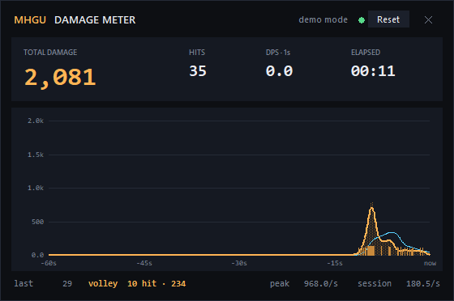

# MHGU Damage Meter

在 Eden 模拟器上实时统计《怪物猎人 XX / Generations Ultimate》玩家伤害的悬浮窗工具。
最初是为了验证 **高帧率贯通弹丢段修复** 是否真的把 60/120fps 的贯通弹伤害拉回 30fps 水平。



## 功能

- **实时总伤害**：当前会话累计伤害，Reset 清零。
- **命中次数**：累计伤害数字个数，用来判断多段弹/多段招式有没有丢段。
- **齐射分组（volley）**：0.8 秒内的连续命中算一次齐射，底部实时显示
  `volley 4 hit · 312`。测贯通弹时看这个数字最直接：一发贯通弹命中几段一目了然。
- **DPS**：1 秒窗口 DPS、5 秒平滑曲线、会话平均 DPS、峰值 DPS。
- **伤害曲线**：最近 60 秒的每秒伤害折线 + 5 秒平滑线 + 每次命中的底部刻度。
- **无边框悬浮窗**：置顶、半透明、可拖动、Esc 关闭，不挡游戏操作。
- 纯 Python 标准库（Tkinter），不需要 matplotlib / PyQt。

## 原理

MHGU 1.4.0（main Build ID `FB08F1D20FD1204FE7070672777F869B`）在产生伤害数字时执行：

```asm
; main + 0xC02074
str r8, [r4, #0xd74]      ; r8 = 本次伤害，r4 = 伤害数字环槽位
```

工具通过 Eden 的 **GDB stub** 在这条指令上放一个软件断点，每次命中时读取 `r8`，
累加后继续运行。地址是 main 模块相对偏移，所以不受 ASLR 影响。

> 这个断点位置与 `attack_damage_display.nro`（show-damage 插件）使用的伤害事件路径一致。
> 工具不修改游戏文件，也不修改 cheat，只在调试器层面读寄存器。

## 环境要求

- Windows（Eden 的 GDB stub 在 Windows 上验证过；Linux/macOS 理论可用）
- Python 3.10+
- Eden 模拟器，已安装 MHGU 1.4.0
- Eden 的 **GDB stub** 已启用（见下）
- 同一时间只启用一个帧率 mod（60fps 或 120fps，不能同时启用）

## 安装 / 使用

### 1. 启用 Eden 的 GDB stub

Eden 主界面按 `Ctrl+,` 打开全局设置 → **调试** 标签页：

- 勾选 **开启 GDB 调试**
- 端口填 `12345`
- 点 **OK**

> Eden 默认端口是 6543，但 Windows 的 Hyper-V/WSL 经常把 `6507-6606` 整段排除，
> 6543 会 bind 失败并在 Eden 日志里报 `bind ... 10013`。所以这里用 12345；
> 如果 12345 也被占用，换一个没被排除的端口，并在运行时加 `--port`。
>
> 改完端口后要**重启 Eden**（或至少重启游戏），GDB stub 才会在新端口监听。
>
> 如果游戏在启动时停住不动，说明 GDB stub 已开启但还没有调试器连接。
> 先运行本工具（它会自动连接并继续游戏），再启动游戏。

### 2. 运行伤害统计

```powershell
python main.py
```

或者双击 `start.bat`。

工具会等待 `127.0.0.1:12345`，连接后自动继续游戏，并显示悬浮窗。

### 3. 启动游戏

在 Eden 里启动 MHGU。悬浮窗会显示 `connected` / `capturing`，打中怪物后总伤害开始增加。

- `Reset`：清零当前会话
- 拖动标题栏：移动窗口
- `Esc` 或右上角 `✕`：退出

### 命令行参数

```text
python main.py --port 12345        # GDB stub 端口
python main.py --no-gui           # 控制台输出，不开窗
python main.py --demo             # 合成数据，预览 UI（不需要模拟器）
python main.py --probe            # 打印原始命中寄存器和环槽位，排查问题
```

## 测试靶场：训练场的固定木桩

贯通弹伤害对 **距离、角度、命中部位肉质** 极其敏感。怪一跳、一转身，两次射击的伤害就没有可比性，
所以测这个 bug 必须用 **静止、固定肉质** 的目标。

好消息：MHGU 自带这样的靶场。

- 地图 ID `9`（`m09d`）是 **训练场**，里面有一个固定的训练木桩/靶子
  （任务数据里的对象 ID `0x55`）。
- 武器的 **风格训练任务** 都在这张图：
  - 轻弩 Guild Style：`questData_0030245`
  - 重弩 Guild Style：`questData_0030249`
  - 弓 Guild Style：`questData_0030253`
  - 其他武器/风格在 `0030201`–`0030298` 这一段。
- 这些任务给固定武器和补给箱，目标就是打训练场的靶子；没有随从猫，没有乱跑的怪。

**先去游戏里试这个：**

1. 找 Bherna 的 **Master of Style** / 训练任务，选 **Light Bowgun → Guild Style**
   （或 Heavy Bowgun）。
2. 进任务后看补给箱里有没有 **贯通弹（Pierce Ammo）**。
3. 有的话，直接站在固定距离对着木桩打，就是最干净的测试环境，**不需要任何任务 mod**。

如果训练任务只给通常弹、或者锁装备导致你不能用自己配好的贯通弩，那就做一个 **任务 mod**：
把一张普通 1★ 任务的地图改成训练场（map 9）并只留训练木桩，保留“带自己的装备/道具”的规则。
任务数据是固定 329 字节的 `.ext`，格式已经摸清（map 在 `0x14`，怪物/对象表在 `0x20` 和 `0x60`），
改一个 RomFS overlay 就能做到；需要的话我可以直接生成到
`load/0100770008DD8000/` 下。

> 游戏里还留着一批开发者测试任务：`0090000`（Dummy Man + 2 Basarios）、
> `0090010`（dummy + Bloodbath Diablos）等。它们也能证明“Dummy Man”这种固定靶的存在，
> 但里面有会动的 Basarios/Diablos，不如训练场干净。

## 用这个工具验证贯通弹修复

1. 只启用 **一个** 帧率 mod（30fps 原版 / 60fps / 120fps）。
2. 进训练场任务，站在 **固定位置**，用 **固定距离/角度** 对着木桩的同一高度射击。
3. **解散随从猫**；不要带会改变伤害的临时 buff（鬼人药、怪力种子等），
   三组测试保持同一套装备/技能。
4. 每次测试前按 `Reset`，打固定发数（例如 10 发贯通弹），记录：
   - **HITS**：总命中段数
   - **volley**：最近一发命中了几段
   - **TOTAL DAMAGE**：总伤害
5. 分别在 30 / 60 / 120fps 下重复，最好每种 10 发，记录每发的段数分布。

预期：

- **未打贯通补丁**：120fps 的总伤害/命中次数明显低于 30fps。
- **打了贯通补丁**：120fps 的总伤害/命中次数回到 30fps 水平（个别情况下会略高，因为高帧率碰撞采样更密）。

命中次数比总伤害更直观：贯通弹每一段是一个独立的伤害数字。

## 限制

- 断点地址只适用于 **MHGU 1.4.0**（Build ID 见上）。其他版本需要重新定位。
- 每次伤害数字会让游戏短暂停在断点（毫秒级）。极高射速下可能有轻微开销。
- 统计的是“伤害数字环”里的所有条目，当前不区分玩家 / 随从 / 其他来源；
  随从猫的伤害会算进总数。后续可以按 owner 过滤。
- 如果游戏本身没有开启伤害数字显示，这个环仍然会被填充（show-damage 插件就是从这里取数的），
  所以工具不依赖游戏 UI 设置。

## 排错

| 现象 | 处理 |
|---|---|
| `GDB stub not found` | Eden 设置 → 调试 → 开启 GDB 调试，端口 12345；重启 Eden |
| 游戏启动后停住 | 先运行 `python main.py`，它会连接并继续游戏 |
| 一直 0 伤害 | 确认游戏版本 1.4.0；运行 `python main.py --probe`，打一下怪，看是否打印 `r8=...` |
| 伤害明显偏大/偏小 | 发一份 `--probe` 输出到 issue；可能需要按版本调整断点或过滤 owner |
| 60/120fps 不生效 | 只保留一个帧率 mod；120fps 的 cheat 四行都要保留 |

## 开发

```text
mhgu_damage/
  gdb.py      GDB RSP 客户端（qOffsets / 读写内存 / 寄存器 / 断点）
  meter.py    断点采集线程 + 统计模型 + demo 数据源
  ui.py       Tkinter 悬浮窗和 Canvas 伤害曲线
main.py       CLI 入口
tools/probe.py 原始命中探针
```

无第三方依赖，`python -m py_compile` 即可检查语法。UI 预览：

```powershell
python main.py --demo
```

## English summary

A dependency-free Tkinter overlay that reads MHGU 1.4.0 damage numbers through
Eden's GDB stub. It places a breakpoint on `main+0xC02074` (`str r8, [r4, #0xd74]`),
reads `r8` on every hit, and shows total damage, hit count, DPS, and a rolling
60-second damage curve. It was written to verify that the high-FPS pierce fix
actually restores 120fps pierce damage to the 30fps baseline.

Only one FPS mod (60 or 120) may be enabled at a time. The breakpoint offset is
specific to MHGU 1.4.0 (main build ID `FB08F1D20FD1204FE7070672777F869B`).

## License

MIT
